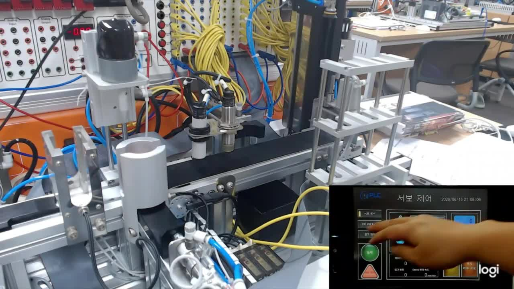
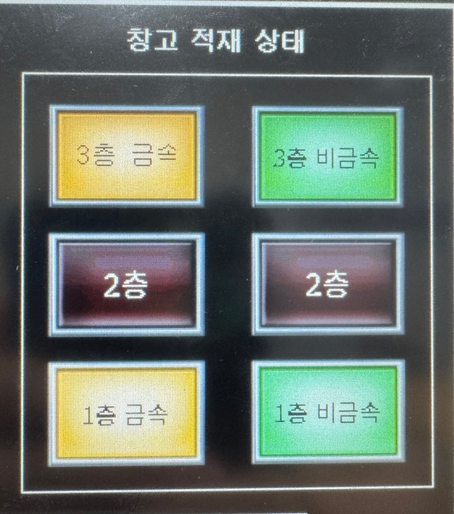
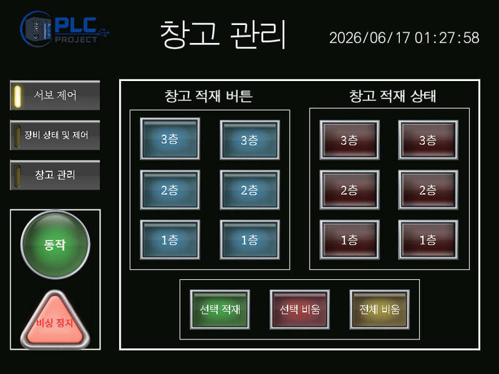
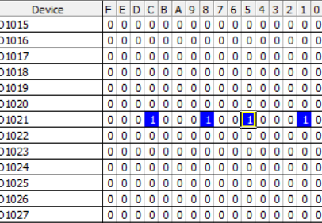
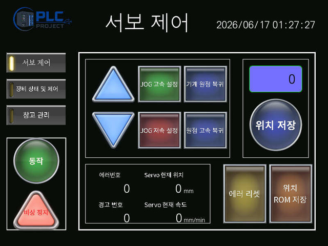
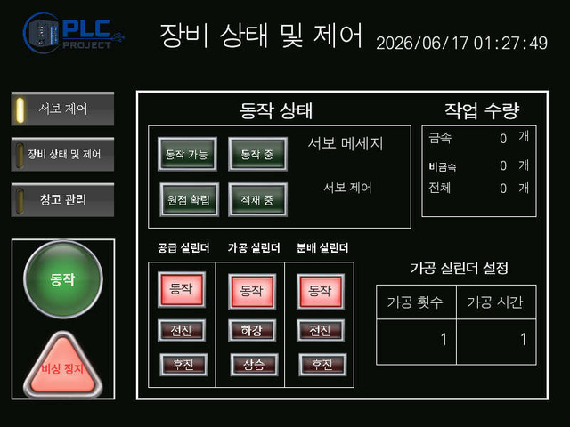
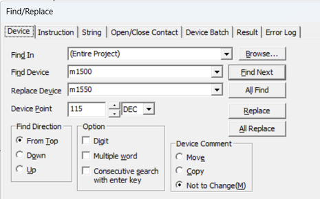
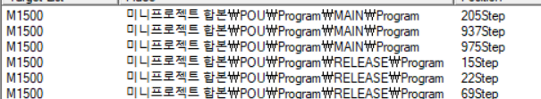
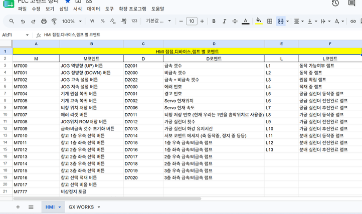

# 🏭 PLC Automated Warehouse

> 금속·비금속 소재를 분류하고 저장 위치를 관리하며, 자동·선택·전체 배출을 수행하는 PLC 기반 자동화 공정 시스템

## 📌 Overview

소재 공급부터 분류·적재·출고까지 연결한 자동화 공정 프로젝트입니다. 소재의 종류와 저장 위치를 기억하고, 같은 종류의 소재가 3개 쌓이면 해당 소재를 자동으로 배출합니다. HMI에서는 창고 상태를 확인하고 원하는 위치만 선택하거나 창고 전체를 비울 수 있습니다.



[🎬 시연 영상 1](assets/videos/demo-01.mp4) · [🎬 시연 영상 2](assets/videos/demo-02.mp4)

## 👤 My Contribution

**담당: 신동민 · 배출 시퀀스 및 창고 비움 기능**

| 담당 기능 | 구현 내용 |
|---|---|
| 배출 시퀀스 | 창고 위치 이동 → 소재 흡착 → 배출 컨베이어 이동 → 소재 해제 흐름 구성 |
| 선택 배출 | HMI에서 선택한 위치 중 소재가 있는 위치만 배출 |
| 전체 배출 | 창고 내 소재가 있는 위치를 탐색해 순차적으로 배출 |
| 작업 전환 | 진행 중인 기본 동작 시퀀스를 완료한 후 선택 배출로 전환 |
| 인터락 | 배출 동작 중 다른 배출 명령이 실행되지 않도록 제어 |

**Stack**


아래의 전체 공정·HMI·소재 위치 관리는 팀 시스템 구성입니다. 개인 담당 내용은 위의 배출 제어 범위를 기준으로 정리했습니다.

## 🔄 System Workflow

| 단계 | 동작 |
|---|---|
| ① 공급·가공 | 공급 센서로 소재를 확인하고 공급 시퀀스 수행 |
| ② 이송·분류 | 컨베이어로 이동하며 금속·비금속 구분 |
| ③ 적재 | 스토퍼 센서 검출 후 창고에 적재하고 소재 종류·위치 기록 |
| ④ 수량 확인 | 같은 종류의 소재가 3개 적재되었는지 확인 |
| ⑤ 배출 | 해당 소재를 배출한 뒤 공급 상태에 따라 다음 작업 진행 |

## ⚙️ Key Features

### Automatic Discharge

같은 종류의 소재가 3개 적재되면 저장 위치 정보를 이용해 해당 소재를 배출합니다. 금속과 비금속이 섞여 적재되어도 소재별 위치를 구분합니다.

<p align="center">
  
</p>

HMI에서 **금속은 노란색, 비금속은 초록색**으로 표시합니다.

### Selective & Full Discharge

<p align="center">
  
</p>

| 모드 | 사용 방법 | 제어 방식 |
|---|---|---|
| 선택 배출 | 창고 위치를 선택한 뒤 **선택 비움** 실행 | 선택한 위치에 소재가 있을 때만 배출하며, 빈 위치는 제외 |
| 전체 배출 | **전체 비움** 실행 | 소재가 있는 위치를 순서대로 탐색하여 모두 배출 |

기본 동작 중 선택 배출을 요청하면 현재 시퀀스를 마친 후 전환합니다. 배출 작업 중에는 다른 배출 모드의 개입을 막아 동작 순서가 겹치지 않도록 했습니다.

### Discharge Sequence

| 순서 | 배출 제어 흐름 |
|---|---|
| 1 | 기본·선택·전체 배출 모드 확인 |
| 2 | 해당 모드의 배출 대상과 우선순위 확인 |
| 3 | 서보를 창고 위치로 이동하고 소재 흡착 |
| 4 | 배출 컨베이어 위치로 이동하고 소재 해제 |
| 5 | 배출 대상에 따라 위 동작을 순차 수행 |
| 6 | 배출 완료 후 공급 소재가 있으면 적재 시퀀스로, 없으면 초기 상태로 복귀 |

## 🧩 Material & Position Tracking

창고의 **6개 위치 × 2가지 소재 종류**를 D 디바이스 1 Word의 비트로 관리했습니다. 16비트 중 12비트를 사용해 소재 종류와 위치를 함께 표현하고, 비트 상태로 배출 대상을 판단합니다.

<p align="center">
  
</p>

| 설계 의도 | 고려한 점 |
|---|---|
| 위치 정보를 하나의 Word로 통합 | 전체 적재 상태를 함께 확인·관리 |
| 소재별 위치를 비트로 구분 | 금속·비금속 배출 대상 판별 |
| 제한된 저장 공간에 맞춘 구성 | 위치·소재 종류 확장 시 비트 규약과 데이터 구조 재검토 필요 |

## 🖥️ HMI

<table>
  <tr><th>Servo Control</th><th>Equipment Control</th></tr>
  <tr>
    <td></td>
    <td></td>
  </tr>
  <tr>
    <td>JOG 이동, Teaching, 서보 상태 확인</td>
    <td>장비·실린더 상태, 소재별 작업 수량, 가공 설정</td>
  </tr>
</table>

창고 관리 화면에서는 저장 위치 선택, 소재별 적재 상태 확인, 선택 비움·전체 비움을 조작합니다.

## 🛠️ Troubleshooting

### 1. 배출 모드가 동시에 개입하는 문제

| 구분 | 내용 |
|---|---|
| **문제 발생** | 선택 비움 진행 중 전체 비움 버튼을 누르면 두 시퀀스가 동시에 개입하여 동작 흐름이 꼬였습니다. |
| **문제 해결 과정** | 특정 배출 동작이 진행 중일 때 다른 배출 명령이 실행되지 않도록 인터락을 추가했습니다. |
| **결과** | 진행 중인 배출 모드에 다른 배출 모드가 개입하지 않도록 제어했습니다. |

### 2. SET 디바이스의 리셋 대상·범위 오류

| 구분 | 내용 |
|---|---|
| **문제 발생** | 여러 M 디바이스를 SET으로 사용하면서 잘못된 디바이스를 리셋하거나 BKRST 범위를 잘못 지정하는 문제가 발생했습니다. |
| **문제 해결 과정** | 검색 및 디바이스 참조 확인으로 사용 위치를 추적하고, 리셋 대상과 범위를 수정했습니다. |
| **결과** | 잘못 지정된 리셋 대상을 찾아 수정했습니다. |

<details>
<summary>디바이스 검색·참조 확인 화면</summary>




</details>

### 3. 코드 통합 시 디바이스 중복·종속성 문제

| 구분 | 내용 |
|---|---|
| **문제 발생** | 협업 중 같은 M 디바이스를 중복 사용하거나 기존 번호를 변경하면서 다른 동작에 영향을 주었습니다. |
| **문제 해결 과정** | 스프레드시트에 디바이스 할당과 사용 규칙을 정리하고 공유했습니다. |
| **결과** | 통합 시 디바이스 사용 영역과 변경 영향을 확인할 수 있는 공통 기준을 마련했습니다. |

<details>
<summary>공유 디바이스 할당표 화면</summary>



</details>

## 📁 Project Files

```text
plc/                  GX Works2 프로그램 원본
  alternate/          별도 압축 파일에 포함되어 있던 프로그램
hmi/project/          HMI 프로젝트 원본 폴더
config/               모터 설정 파일·이미지
assets/images/        장비·HMI·디바이스 화면
assets/videos/        시연 영상 원본 2개
docs/                 발표자료·대본·파일 안내
```

[📂 PLC 프로그램](plc) · [🖥️ HMI 프로젝트](hmi/project) · [📖 파일 및 실행 안내](docs/project-guide.md)

GX Works2와 GT Designer3 프로젝트를 원본 형태로 보존했습니다. 파일별 출처와 버전 구분은 [프로젝트 안내](docs/project-guide.md)에 정리했습니다.
